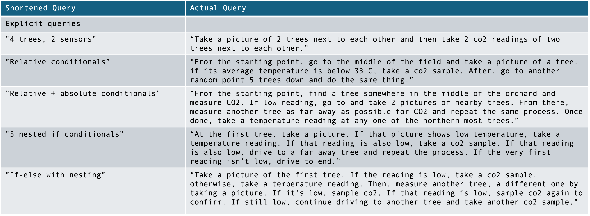
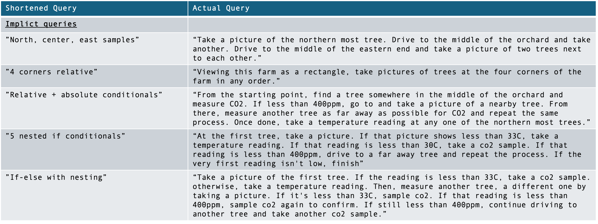
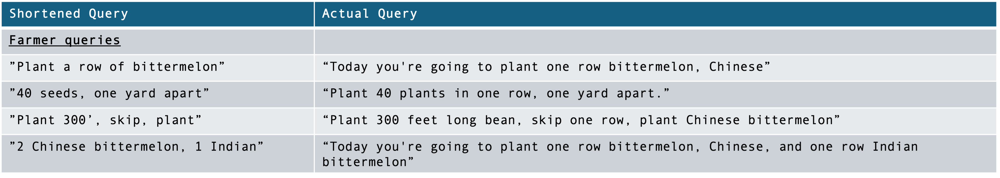

# GPT-Powered Robot Mission Planner
[](https://github.com/ucmercedrobotics/gpt-mission-planner/actions/workflows/ci.yml)
[](https://github.com/ucmercedrobotics)
[](https://robotics.ucmerced.edu/)
[](https://www.python.org)
[](https://github.com/pre-commit/pre-commit)
[](https://github.com/psf/black)
<!-- [](http://mypy-lang.org/) -->
<!-- TODO: work to enable pydocstyle -->
<!-- [](http://www.pydocstyle.org/en/stable/) -->

GPT Mission Planner turns natural-language requests into
[BehaviorTree.CPP](https://www.behaviortree.dev/) missions for ROS 2 robots. Before it sends a
mission, it checks the XML against the robot's XSD schema of action primitives.
It can also verify each mission formally (LTL, checked with SPIN and Spot), and it can divide one
request across a fleet of robots that register with it.
The planner runs in one Docker container, with a web interface and a command-line interface, and
uses cloud LLMs or a local OpenAI-compatible model server.
It is for operators, such as farmers, who want to give a robot a mission in plain language; for
integrators who connect ROS 2 robots to it; and for researchers who study LLM-based mission planning.

https://github.com/user-attachments/assets/cd18a3b1-1cd3-48e9-ae74-825cca88b508

## Requirements

Planner host:

- Docker, on Linux (amd64 or arm64) or macOS. Everything else runs in the container.
- One of:
  - an API key for an LLM provider that [LiteLLM](https://docs.litellm.ai/docs/providers)
    supports (the default configuration uses OpenAI), or
  - a local OpenAI-compatible model server, for example [vLLM](https://docs.vllm.ai/).
- Optional, for formal verification: [SPIN](https://spinroot.com/) and
  [Spot](https://spot.lre.epita.fr/), which are built into the image with
  `ENABLE_VERIFICATION=true` (the published image already has them), and an Anthropic API key,
  because the default configuration uses Anthropic models for LTL generation and for the arbiter.
- Optional: Python 3.10 or later on the host, to run the mock robot in
  [scripts/mock_robot.py](scripts/mock_robot.py) (standard library only).

Robot side:

- A BehaviorTree.CPP receiver that accepts the planner's TCP frames and, for fleet use, registers
  with the planner. See [docs/robot_contract.md](docs/robot_contract.md).
- BehaviorTree.CPP nodes for the action primitives in the robot's schema. The schemas are in the
  [gpt-mission-planner-schemas](https://github.com/ucmercedrobotics/gpt-mission-planner-schemas)
  repository, included here as the `schemas/` submodule.

## Installation

Clone the repository with its submodules:

```bash
git clone --recurse-submodules https://github.com/ucmercedrobotics/gpt-mission-planner.git
cd gpt-mission-planner
```

Create a `.env` file in the repository root with your API keys:

```bash
OPENAI_API_KEY=<my_token_here>
ANTHROPIC_API_KEY=<my_token_here>
```

The default configuration ([app/config/localhost.yaml](app/config/localhost.yaml)) uses OpenAI for
the mission XML and Anthropic for LTL generation and the arbiter, and it turns formal verification
on. If you turn verification off (`planner.validation.ltl_enabled: false`), you only need the
OpenAI key. You can also set the speech-to-text model in `.env`, for example:

```bash
WHISPER_MODEL=small
WHISPER_DEVICE=cpu
WHISPER_COMPUTE_TYPE=int8
```

Then get the image in one of two ways.

**Published image (recommended).** The image is published as
`ghcr.io/ucmercedrobotics/gpt-mission-planner` for amd64 and arm64, and it is built with formal
verification. This README describes release `v1.0.1`. The `make` targets use the `latest` tag, so
pull the release and tag it:

```bash
docker pull ghcr.io/ucmercedrobotics/gpt-mission-planner:v1.0.1
docker tag ghcr.io/ucmercedrobotics/gpt-mission-planner:v1.0.1 ghcr.io/ucmercedrobotics/gpt-mission-planner:latest
```

**Local build.**

```bash
make build-image                            # without formal verification
make build-image ENABLE_VERIFICATION=true   # with SPIN and Spot (Spot is compiled from source, which is slow)
```

An image built without verification has no SPIN or Spot. The default configuration turns
verification on, so with such an image the planner stops at startup with an error. Set
`planner.validation.ltl_enabled: false` in [app/config/localhost.yaml](app/config/localhost.yaml)
to run it without verification.

## Quick start

Start the web interface:

```bash
make prod
```

Open http://localhost:8002. To use another host port, run `WEB_PORT=8080 make prod`.
`make prod` runs the container in the background. To stop it, run
`docker ps` to get the container ID, then `docker stop <container-id>`.

To see the mission that the planner delivers without a robot, open a second terminal and run:

```bash
make server
```

This listens on `172.17.0.1:12346`, the Docker bridge address on Linux, and writes everything
it receives to `test.bin`. When no robot has registered, the planner sends each mission to the
`network.tcp` address in the configuration, which is this listener. Type a request in the web
interface. Then run `strings test.bin` to see the mission XML and the orchard JSON. The format is
described in [docs/robot_contract.md](docs/robot_contract.md#4-receive-a-mission). `make server`
uses the bridge address, so it works only on a Linux host.

## Example usage

This example goes from a request to the XML that a robot receives. It uses the mock robot in
[scripts/mock_robot.py](scripts/mock_robot.py) in place of a real robot. You need the `.env` keys
from [Installation](#installation), because the planner calls an LLM.

1. Start the planner (if it is not already running):

   ```bash
   make prod
   ```

2. In a second terminal, start a mock robot. It registers with the planner's discovery API on
   port 8003, listens for missions on port 12346 and prints each behavior tree that it receives.
   Stop `make server` first if it is running, because it uses the same port.

   ```bash
   python3 scripts/mock_robot.py --robot-id amiga-01 --bt-port 12346 --print-xml
   ```

3. Confirm that the planner sees the robot:

   ```bash
   curl -s http://localhost:8003/robots | python3 -m json.tool
   ```

   The response lists `amiga-01` with `"liveness": "online"` and `"eligible": true`.

4. Open http://localhost:8002. In the settings, keep **Target** at **Auto (discovered fleet)**
   and the default farm. Enter this request in **Mission prompt** and send it:

   ```text
   Can you please visit Tree 1 and Tree 4, but don't approach them?
   ```

5. The planner generates the mission, validates it against `schemas/amiga_btcpp.xsd` and sends it
   to `amiga-01`. The mock robot logs the frames and the behavior tree, then sends an
   acknowledgement (shortened here; the mission ID and sizes are different on each run):

   ```text
   [amiga-01] INFO Frame 1: behavior tree, ... bytes
   [amiga-01] INFO Frame 2: ... bytes, ... trees
   [amiga-01] INFO --- mission ... ---
   [amiga-01] INFO   for robot:  amiga-01
   [amiga-01] INFO   behavior tree:
   <root BTCPP_format="4" ...>
   ...
   [amiga-01] INFO Ack sent: {'accepted': True, 'robot_id': 'amiga-01', ...}
   ```

   The web interface shows the same XML and the trees that the mission visits on the map.
   [examples/orchard_demo/multirow_navigation.xml](examples/orchard_demo/multirow_navigation.xml)
   is a mission for this request:

   ```xml
   <root BTCPP_format="4" schema_location="schemas/amiga_btcpp.xsd">
     <Mission>Can you please visit Tree 1 and Tree 4, but don't approach them?</Mission>
     <BehaviorTree ID="VisitTree1AndTree4">
       <Sequence>
         <MoveToAisleHead name="EnterColumn1" action_name="move_to_aisle_head" id="1" />
         <MoveToTreeID name="VisitTree1" action_name="follow_tree_id_waypoint" id="1" approach_tree="false" />
         <MoveToAisleHead name="ExitColumn1" action_name="move_to_aisle_head" id="1" />
         <MoveToAisleHead name="EnterColumn4" action_name="move_to_aisle_head" id="4" />
         <MoveToTreeID name="VisitTree4" action_name="follow_tree_id_waypoint" id="4" approach_tree="false" />
       </Sequence>
     </BehaviorTree>
   </root>
   ```

   The LLM output can be different from this file, but it must pass validation against the same
   schema. The other files in [examples/orchard_demo/](examples/orchard_demo/) are missions for
   other requests. When **Save entire mission to logs** is on, the planner also saves the request
   and the mission in `logs/missions/`.

6. Stop the mock robot with Ctrl-C. It deregisters from the planner.

To try more than one robot, start a second mock robot with `--robot-id amiga-02 --bt-port 12347`,
and ask for a mission that covers the whole orchard. The planner divides it between the two.

More example requests:







## Command-line interface

The command-line interface runs in the container. Open a shell in it:

```bash
make bash
```

`make bash` mounts `app/`, `schemas/`, `scripts/`, `test/` and `logs/` from your clone, and reads
`.env`. In the container, run the planner with the default configuration:

```bash
make run
```

Or select a configuration file:

```bash
CONFIG=./app/config/kinova.yaml make run
```

The planner asks for a request (`Enter the specifications for your mission plan:`), generates
the mission and sends it to the registered robots or to the `network.tcp` address.

In the same shell, `make webapp` starts the web interface on port 8002 with the configuration
files from your clone. `make prod` uses the files that are built into the image.

## Configuration and documentation

- [app/config/README.md](app/config/README.md) describes the configuration files and every option,
  including model routing (`online`, `offline` or `auto`) and local model servers.
- [docs/robot_contract.md](docs/robot_contract.md) describes what a robot must implement:
  registration, heartbeats, the TCP mission format and the acknowledgement.
- [gpt-mission-planner-schemas](https://github.com/ucmercedrobotics/gpt-mission-planner-schemas)
  contains the action-primitive schema (XSD) for each robot.

The web server ([app/server.py](app/server.py)) and the command-line interface
([app/cli.py](app/cli.py)) both call the `MissionPlanner` core in
[app/mission_planner.py](app/mission_planner.py).

**Fleet discovery.** When `fleet.enabled` is `true` (as in the default configuration), robots
register with the planner on port 8003 and send heartbeats. The planner divides each mission across
the robots that are online and idle, using the schema that each robot reports. When no robot is
registered, the planner sends missions to the single `network.tcp` address. Formal verification
applies only to these single-robot missions; the planner skips it for fleet missions. See
[docs/robot_contract.md](docs/robot_contract.md) and its reference implementation,
[scripts/mock_robot.py](scripts/mock_robot.py).

## Running the tests

In the container (`make bash`):

```bash
python3 -m pytest test/ -v
```

The tests do not call an LLM, so they do not need API keys. `make bash` reads `.env`, so the file
must exist, but it can be empty. CI runs the same tests on each push and pull request to `main`
(see the CI badge at the top of this file).

## Contributing and support

See [CONTRIBUTING.md](CONTRIBUTING.md) for how to report a bug, ask a question, set up a
development environment and send a pull request. Report problems and ask questions in the
[issue tracker](https://github.com/ucmercedrobotics/gpt-mission-planner/issues).

## License

This project is licensed under the Apache License 2.0. See [LICENSE](LICENSE).

## Citation

If you use this software, please cite:

<!-- [JOSS paper BibTeX; after acceptance.] -->

```latex
@INPROCEEDINGS{zuzuarreguiICRA2025,
  author={Zuzuárregui, Marcos Abel and Carpin, Stefano},
  booktitle={2025 IEEE International Conference on Robotics and Automation (ICRA)},
  title={Leveraging LLMs for Mission Planning in Precision Agriculture},
  year={2025},
  pages={7146-7152},
  keywords={Precision agriculture;Large language models;Natural languages;Data collection;Routing;Chatbots;Libraries;Cognition;Planning;Standards},
  doi={10.1109/ICRA55743.2025.11128633}
  }
```

For the formal verification extension, please cite:
```latex
@INPROCEEDINGS{zuzuarreguiICRA2026,
  author={Zuzuárregui, Marcos Abel and Carpin, Stefano},
  booktitle={2026 IEEE International Conference on Robotics and Automation (ICRA)},
  title={As You Wish: Mission Planning with Formal Verification using LLMs in Precision Agriculture},
  year={2026},
  pages={1282-1289},
  keywords={Planning;Large language models;Modeling;Robots;XML;Trees (botanical);Vegetation;Printing;Spinning;Radio access networks},
  doi={10.1109/ICRA57385.2026.11697380}
  }
```

## Publications that use the planner

- M. A. Zuzuárregui and S. Carpin, "Leveraging LLMs for Mission Planning in Precision
  Agriculture," in *Proceedings of the IEEE International Conference on Robotics and
  Automation (ICRA)*, 2025, pp. 7146–7152. doi:10.1109/ICRA55743.2025.11128633.
  Release: `icra-2025`.
- M. A. Zuzuárregui et al., "One for All: LLM-Based Heterogeneous Mission Planning in
  Precision Agriculture," in *Proceedings of the IFAC Conference on Sensing, Control and
  Automation Technologies for Agriculture*, 2025. Release: `ifac-2025`.
- M. A. Zuzuárregui and S. Carpin, "As You Wish: Mission Planning with Formal Verification
  Using LLMs in Precision Agriculture," in *Proceedings of the IEEE International
  Conference on Robotics and Automation (ICRA)*, 2026, pp. 1282–1289.
  doi:10.1109/ICRA57385.2026.11697380. Release: `icra-2026`.
- M. A. Zuzuárregui, A. Abedi, R. Ehsani, and S. Carpin, "An End-to-End Software
  Architecture Integrating Natural Language Mission Planning and Behavior Trees for
  Precision Agriculture," *IEEE Transactions on Field Robotics*, vol. 3, pp. 899–918,
  2026. doi:10.1109/TFR.2026.3736546. Release: `tfr-2026`.
