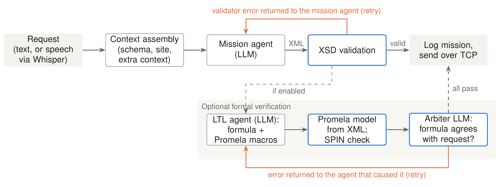

# Summary

GPTMissionPlanner converts typed or spoken natural language (NL) requests into BehaviorTree.CPP (BT.CPP) [@faconti_behavior_tree_cpp_2018] missions for ROS 2 [@macenski_robot_2022] robots.
A large language model (LLM) decomposes each request into the action primitives of the target robots.
An XML schema check rejects plans that a robot cannot execute, and returns the error to the LLM so that it can correct the plan.
Optional formal verification checks plan intent with temporal logic.
Robots register with the planner, which divides each mission across the available fleet.
The planner ships as one container and runs with cloud or local models.
We have demonstrated it in commercial pistachio and citrus orchards with a mobile robot and a mounted manipulator [@zuzuarregui2026tfr].

# Statement of need

In precision agriculture, our domain of interest, robots operate in partially structured environments, often with limited network connectivity, and must be reliable and safe under uncertainty [@AccessSurvey; @wang2024survey; @droukas2023survey].
Non-technical users will operate them, so adoption depends on how easily the software is configured and repurposed.

GPTMissionPlanner links NL mission specification to robot execution through BT.CPP, the behavior tree (BT) engine of the ROS 2 navigation stack Nav2.
A ROS 2 robot needs only a schema of its action primitives and BT.CPP nodes that call its existing action servers; it does not need to change its software stack.
The software has three groups of users.
Operators, such as farmers, give missions in their own words through a browser.
Integrators connect a new or existing ROS 2 robot by writing one schema and a set of BT.CPP nodes.
Researchers use the planner as a base for work on LLM-based planning.

# State of the field

LLMs are now a common front end for robot autonomy [@ahn_as_2022; @liang_code_2023].
Early systems translated user intent into executable scripts [@liang_code_2023; @huang_language_2022] but often lacked verifiable outputs.
Planners built on the Planning Domain Definition Language (PDDL) need a complete world model [@zeng_emboteam_2026].
More recent work grounds the LLM with external validators, through syntax feedback loops [@CarpinLLMSubmitted] or formal verification [@zuzuarregui2025asyouwish], or by generating BTs [@ao_llm-as-bt-planner_2025; @11127942; @izzo_btgenbot_2024].
Most of these systems are research prototypes and do not target the BT engine of production ROS 2 stacks.
Containers already solve dependency isolation for ROS 2 [@zhang_distributed_2022; @lim_docker-enabled_2026] and support fleet orchestration [@lampe_robotkube_2023; @lumpp_enabling_2024]; the planner follows this practice.

\autoref{tab:compare} compares GPTMissionPlanner with three tools that connect LLMs to ROS robots: ROSA [@royce_rosa_2024], ROS-LLM [@mower_rosllm_2024], and BTGenBot-2 [@izzo_btgenbot2_2026], the closest tool, which generates BT.CPP XML with a fine-tuned model.

|                          | ROSA                        | ROS-LLM                 | BTGenBot-2              | GPTMissionPlanner            |
|--------------------------|-----------------------------|-------------------------|-------------------------|------------------------------|
| Output                   | ROS tool calls              | Python, JSON, or XML BT | BT.CPP XML              | BT.CPP XML                   |
| Check before execution   | Tool-level parameter checks | None described          | XML syntax, action list | XSD, with LLM retry          |
| Formal verification      | No                          | No                      | No                      | Optional (LTL, SPIN)         |
| Multi-robot allocation   | Not demonstrated            | Not described           | Not described           | Yes, with fleet discovery    |
| Operator interface       | CLI, web GUI                | Chat                    | Not described           | Web (text, voice), CLI       |

: Comparison with tools that connect LLMs to ROS robots, from the papers that describe them.\label{tab:compare}

We built a new package instead of contributing to one of these tools.
The outputs of ROSA and ROS-LLM are actions or code, not a mission that a schema can check before execution, and neither targets BT.CPP.
BTGenBot-2 is a model, a dataset, and a benchmark; it has no operator interface, site context, fleet allocation, or mission delivery.
It is complementary: the planner selects its model through configuration, so a specialized local model could replace a general-purpose one.
The design, inspired by the IEEE Standard for Robot Task Representation [@noauthor_ieee_2024], separates NL mission generation from robot control.

# Software design

GPTMissionPlanner is a Python application that runs in one Docker container, so any host can run it despite the ROS 2 dependence on the operating system.
A FastAPI [@Ramirez_FastAPI] server provides the browser-based operator interface, a second HTTP service lets robots register, and a TCP link delivers each mission to a ROS 2 receiver on the robot, which loads the tree into BT.CPP and executes it; our companion robot-side system [@zuzuarregui2026tfr] is one such receiver.
A Python core (`MissionPlanner`) holds the planning pipeline, and both the web server and the command-line interface call it.
The planner has four layers (\autoref{fig:architecture}): interface (web server and Whisper speech-to-text [@radford2023whisper; @fasterwhisper]), context (Jinja2 prompt templates with the robot schema and site description), planning (LLM agent, schema check, optional verification), and fleet and delivery (robot registry and network module).
Pytest tests cover XML validation, the fleet registry and allocator, and the network interface.

{ width=100% }

*The schema is the robot interface.*
The XML schema definition (XSD) of a robot lists its action primitives, constrains the LLM output to missions that BT.CPP can load, and documents the robot interface.
If a mission fails validation, the planner returns the validator error to the LLM and asks for a new plan, up to a configurable number of retries (\autoref{fig:loop}).
An integrator writes the XSD and the BT.CPP nodes once per robot.
The schemas for our robots (a Bonsai Robotics Amiga, a Kinova Gen3, and a Clearpath Husky) are in a separate repository [@gpt_mp_schemas], included as a git submodule.

*Formal verification is optional.*
When enabled, a second LLM agent writes a linear temporal logic (LTL) formula for the request, the SPIN model checker [@SPINBook] checks a Promela model of the mission against it, and an arbiter LLM checks that the formula agrees with the request.
This step implements the method of @zuzuarregui2025asyouwish.
Verification is necessary only in secure or safety-critical settings, so SPIN and its dependencies are built into the image only on request.

{ width=100% }

*Site context is condensed before it reaches the LLM.*
Raw GPS data for an orchard is too large for the LLM context window.
The operator supplies a GPS polygon of the site, and the planner derives working areas, row orientations, perimeter margins, and tree placement from it.
Only this condensed context goes into the prompt.
The orchard module is optional; our manipulator deployment does not use it.

*The model is a configuration choice.*
All LLM calls go through LiteLLM, so one configuration file selects a cloud model, a local model behind an OpenAI-compatible endpoint (for example, vLLM), or an automatic mode that falls back to the local model without internet access.
With a local LLM and in-container transcription, the planner needs no internet connection.

*Fleet operation keeps a single-robot fallback.*
A robot registers with the discovery API, giving the schema it executes, and then sends periodic heartbeats with status, battery level, and position.
For a new request, the planner selects the eligible robots (online, idle, known schema, enough battery), one LLM call divides the mission over them, and the planner generates and validates one BT per robot.
With no robot registered, the planner uses a single configured host and port.
The repository documents this contract and includes a mock robot.

*Limitations.*
The planner generates a complete mission before execution and uses no real-time robot or perception feedback.
Formal verification is not yet available for multi-robot missions; only the schema check applies.
LLM outputs are not deterministic, so the planner logs each request and mission by default.

# Research impact statement

The planner is the software base of a series of studies by our group, and the repository keeps a tag for the version used in each one: `icra-2025` (syntax-feedback planning for precision agriculture [@CarpinLLMSubmitted]), `ifac-2025` (heterogeneous robots [@CARPINIFAC2025]), `icra-2026` (formal verification of mission intent [@zuzuarregui2025asyouwish]), and `tfr-2026` (robot-side BT execution [@zuzuarregui2026tfr]).
Its fleet discovery and allocation are the base of ongoing work on LLM-assisted task recovery for agricultural robot fleets [@zuzuarregui2027mas].
These studies report research results on planning and execution; none describes the planner software itself.

We used the planner in commercial pistachio and citrus orchards [@zuzuarregui2026tfr].
In the pistachio orchard, it controlled an Amiga mobile platform with a mounted Kinova Gen3 manipulator; the operator gave all commands from a phone, and the missions included following the operator, navigating to named trees, and arm motions.
The generated missions are in `examples/orchard_demo/`.
The planner has been used with OpenAI models from GPT-3.5 to GPT-5.6, with Anthropic models from Claude Sonnet 3.7 to Claude Opus 5.5, and with local models such as GPT-OSS 120B.

# AI usage disclosure

The first author wrote the initial versions of the software without generative AI.
Later development used Claude (Anthropic), mostly Claude Sonnet 4 and Claude Opus 5.5, for code generation, refactoring, tests, and documentation.
Claude Opus 5.5 also helped to edit this paper.
The authors made all core design and architecture decisions, and they reviewed, edited, and validated all AI-assisted code, documentation, and text.
At run time, the software calls LLMs to generate missions, as Software design describes.

# Conflict of interest

The authors declare that they have no known competing financial interests or personal relationships that could have appeared to influence the work reported in this paper.

# Acknowledgements

This work is partially supported by the IoT4Ag Engineering Research Center funded by the National Science Foundation (NSF) under NSF Cooperative Agreement Number EEC-1941529 and under grant CMMI-2326310.
Any opinions, findings, conclusions, or recommendations expressed in this publication are those of the author(s) and do not necessarily reflect the view of the National Science Foundation.
We thank Thomas Morford for his contributions to the software.

# References
